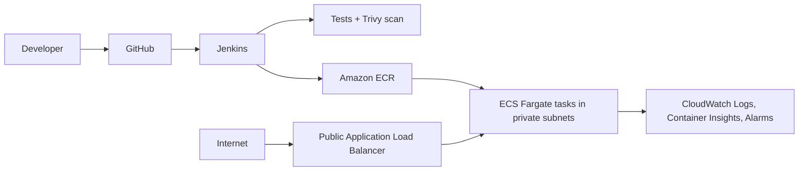
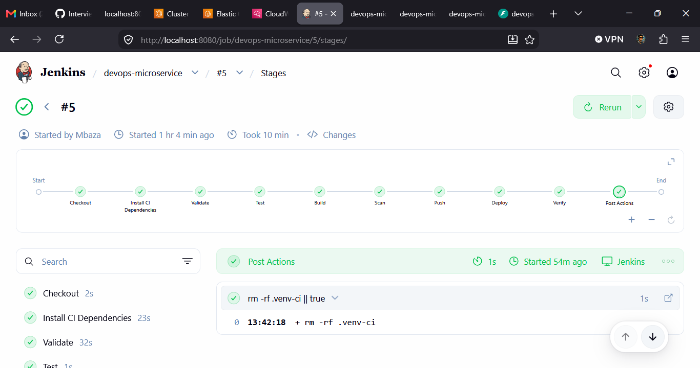
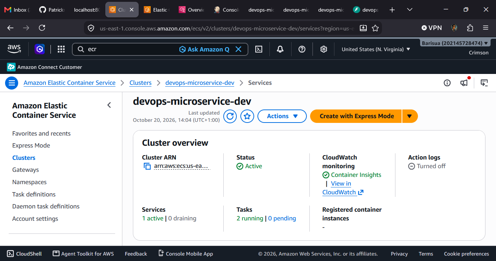
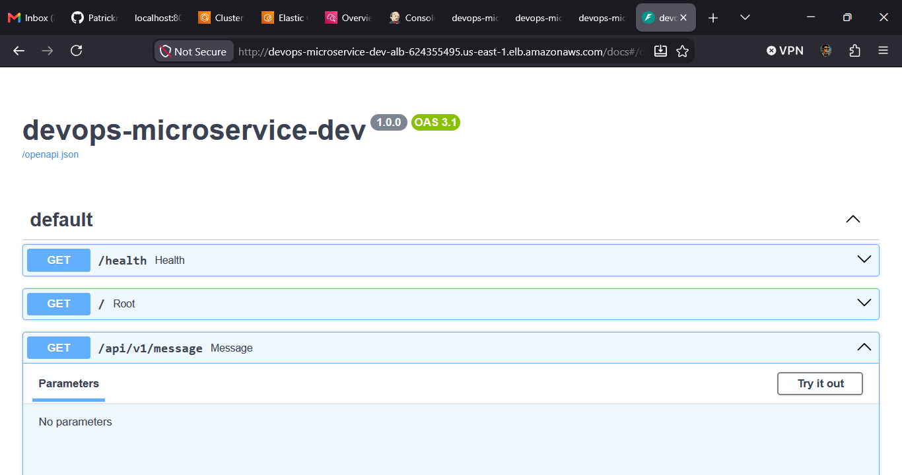
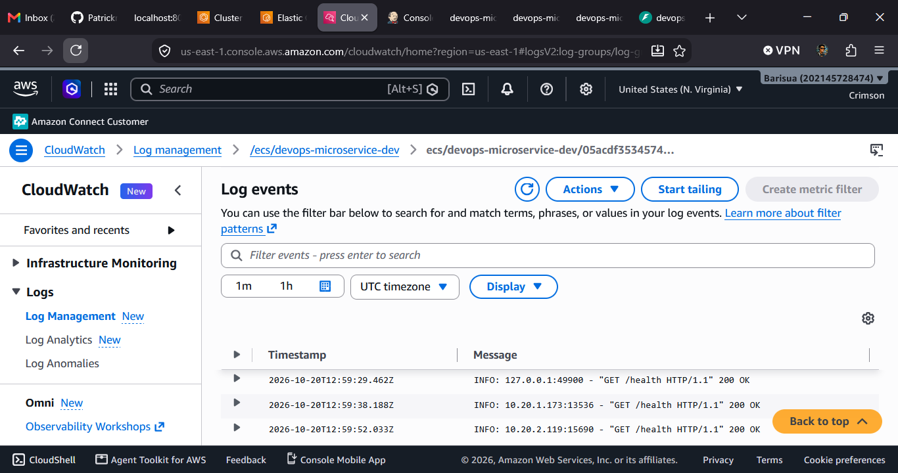
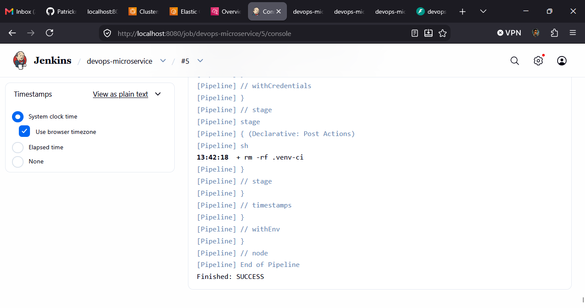

# DevOps Microservice: Jenkins + AWS ECS Fargate

This repository implements the practical challenge from `DevOps Engineer Practical Challenge(1).docx`.

It demonstrates a complete delivery path for a small FastAPI microservice:

1. Code is stored in GitHub.
2. A GitHub webhook triggers Jenkins.
3. Jenkins validates, tests, builds, and scans the application.
4. Jenkins pushes an immutable Docker image to Amazon ECR.
5. Terraform provisions and updates the AWS environment.
6. The service runs on ECS Fargate behind an Application Load Balancer.
7. CloudWatch collects application logs and operational metrics.
8. Jenkins verifies the deployed service through its public health endpoint.

The deployment is repeatable: the Docker image is tagged with the Git commit SHA and the infrastructure is defined in Terraform rather than configured manually in the AWS console.

## Architecture



The ALB is the only public application entry point. Tasks run without public IPs in private subnets. This implementation intentionally uses HTTP; HTTPS requires an ACM certificate, an HTTPS listener, and DNS, which are documented future improvements.

## Deployed architecture evidence

The following screenshots document the completed deployment and are included in the repository root:

### Jenkins pipeline

The Jenkins build shows checkout, validation, testing, Docker build, Trivy scanning, ECR push, Terraform deployment, and health verification.



### AWS ECS service

The ECS screenshot shows the running Fargate service and its deployed tasks.



### Application endpoint

The application is exposed through the Application Load Balancer. The health endpoint returns HTTP 200 after deployment.



### CloudWatch logs

Application container output is sent to the CloudWatch log group `/ecs/devops-microservice-dev`.



### Build and security evidence

The Jenkins build also contains the test result, Docker build output, and Trivy image scan.



## API

- `GET /health` returns a 200 health response.
- `GET /` returns service, version, and environment information.
- `GET /api/v1/message` returns a sample JSON message.

Configuration is supplied with `APP_NAME`, `APP_VERSION`, `ENVIRONMENT`, and `PORT` (default `8000`).

## Repository layout

```text
app/                         FastAPI application
tests/                       pytest tests
Dockerfile                   non-root production image
Jenkinsfile                  CI/CD pipeline
docker-compose.yml           local application container
jenkins/docker-compose.yml   local Jenkins controller
terraform/modules/            networking, ECR, ECS, monitoring
terraform/                    dev environment/root composition
scripts/verify.sh             health verification helper
```

## Prerequisites

For local work: Python 3.12+, Docker, curl, Terraform 1.6+, AWS CLI, and Trivy. For AWS: an AWS account and an IAM principal able to create the resources described below. Never put access keys in Git or the image.

## Bootstrap

The one-time setup can be prepared with `scripts/bootstrap.sh`. It validates the local tools and AWS identity, creates a versioned and encrypted Terraform state bucket, creates the DynamoDB lock table, writes the ignored local `terraform/backend.tf`, and starts the Jenkins controller with Docker Compose.

Run it from the repository root:

```bash
chmod +x scripts/bootstrap.sh
./scripts/bootstrap.sh \
  --region us-east-1 \
  --state-bucket YOUR-GLOBALLY-UNIQUE-TERRAFORM-BUCKET
```

The script asks for confirmation before creating AWS state resources. Use `--skip-backend` when the backend already exists, or `--skip-jenkins` when Jenkins is managed elsewhere. It never stores AWS, GitHub, or Jenkins secrets in the repository and does not destroy resources.

After bootstrap, configure the Jenkins `aws-deploy` credential, create the Pipeline job, and add the GitHub webhook. The application pipeline then handles validation, testing, image scanning, ECR publishing, Terraform deployment, and health verification.

## Local validation

```bash
python3 -m venv .venv && . .venv/bin/activate
pip install -r requirements-dev.txt
pytest -q
ruff check app tests

docker compose up --build -d
curl http://localhost:8000/health
docker compose down
```

## Terraform and AWS deployment

The root module creates a VPC, two public and two private subnets, internet gateway, ECR repository with scan-on-push and immutable tags, ECS cluster/service, ALB, CloudWatch log group, IAM roles, and CPU/unhealthy-target alarms. The task role has no extra permissions; the execution role uses the AWS-managed ECS execution policy for image pulls and log delivery.

The private subnets use NAT gateways so Fargate can pull from ECR and publish CloudWatch logs without public task IPs. NAT gateways incur ongoing AWS charges; a cost-optimized production variant can replace them with VPC endpoints for ECR, S3, and CloudWatch Logs.

Terraform state should use an encrypted, versioned S3 bucket with a DynamoDB lock table. Copy `terraform/backend.tf.example` to `terraform/backend.tf`, replace the placeholders, and create the bootstrap bucket/table using your organization's approved process before `terraform init`. `backend.tf` is ignored by Git. A local state file is acceptable only for a disposable learning account.

```bash
cp terraform/terraform.tfvars.example terraform/dev.tfvars
terraform -chdir=terraform init
terraform -chdir=terraform validate
terraform -chdir=terraform plan -var-file=dev.tfvars -var='image_tag=bootstrap'
```

The first real deployment is performed by Jenkins: it creates only ECR during the Push stage, pushes an immutable commit-SHA image, then applies the complete stack with that image. This avoids starting ECS with an image that does not exist. The initial apply creates AWS resources and may incur charges; review the plan and confirm before running it.

### AWS resources

Terraform provisions the following resources:

- VPC with public and private subnets across two Availability Zones
- Internet Gateway for public traffic
- NAT gateways for private-subnet outbound access
- Security groups for the ALB and ECS tasks
- ECR repository with immutable image tags and scan-on-push
- ECS Fargate cluster, task definition, and service
- Public Application Load Balancer and target group
- CloudWatch log group and ECS/ALB monitoring alarms
- IAM execution and task roles

The ECS tasks do not receive public IP addresses. Traffic enters through the ALB on port 80, is forwarded to the containers on port 8000, and the ALB checks `/health`.

## Jenkins setup

```bash
docker compose -f jenkins/docker-compose.yml up -d
docker logs -f devops-jenkins
```

For a real Jenkins agent, install Docker CLI/daemon access, AWS CLI, Terraform, Python, curl, and Trivy. The Docker socket is powerful; use a dedicated agent and restrict job permissions. Install these plugins: Pipeline, Git, GitHub Integration, Credentials Binding, and AWS Credentials. No paid plugins are required.

Create a Pipeline job connected to this GitHub repository and point it at `Jenkinsfile`. Add a GitHub webhook to `https://JENKINS_HOST/github-webhook/` (or use SCM polling). Configure a Jenkins credential with ID `aws-deploy`, type “AWS Credentials”, scoped to the deployment folder/job. The IAM user or role should be restricted to this repository's ECR actions, ECS service/task-definition actions, ALB/VPC/IAM actions needed by Terraform, CloudWatch log/alarms, and `sts:GetCallerIdentity`; prefer short-lived role credentials in production. Do not echo credentials in shell steps.

The pipeline runs checkout, syntax/Terraform validation, tests, Docker build, Trivy scan, ECR push, Terraform deploy, and an ALB `/health` verification. It uses the Git commit SHA as an immutable image tag, waits for ECS stabilization through Terraform, and skips AWS stages for pull requests (`changeRequest()`). Do not run `terraform destroy` from this pipeline.

## Running the project on a live server

An interviewer can run the complete solution from a Linux server such as an Ubuntu EC2 instance. The server hosts Jenkins; the application itself is deployed by Terraform to AWS ECS Fargate.

### Server requirements

Use a server with at least 2 vCPUs, 4 GB RAM, 30 GB disk space, a public DNS name or public IP, and Docker with the Compose plugin. Configure the firewall/security group as follows:

- TCP 22: administrator's IP only
- TCP 8080: administrator's IP only during Jenkins setup
- TCP 443: recommended when Jenkins is placed behind an HTTPS reverse proxy

The Jenkins webhook endpoint must be reachable from GitHub. For a short-lived demonstration, port 8080 can be exposed to GitHub, but a real deployment should use HTTPS and restrict Jenkins access through a VPN, reverse proxy, or allowlist.

### Start Jenkins on the server

```bash
sudo apt-get update
sudo apt-get install -y git docker.io docker-compose-plugin awscli
sudo systemctl enable --now docker

git clone https://github.com/Patrickmbaza/Interview-project.git
cd Interview-project

chmod +x scripts/bootstrap.sh scripts/destroy.sh
aws configure

./scripts/bootstrap.sh \
  --region us-east-1 \
  --state-bucket YOUR-GLOBALLY-UNIQUE-TERRAFORM-BUCKET
```

The bootstrap script builds and starts the custom Jenkins image. Retrieve the initial administrator password with:

```bash
docker exec devops-jenkins \
  cat /var/jenkins_home/secrets/initialAdminPassword
```

Open `http://SERVER_PUBLIC_IP:8080`, complete the Jenkins setup, and install the Pipeline, Git, GitHub Integration, Credentials Binding, and AWS Credentials plugins.

### Configure the deployment job

Create a Jenkins Pipeline job with:

1. Pipeline definition: **Pipeline script from SCM**
2. SCM: Git
3. Repository: `https://github.com/Patrickmbaza/Interview-project.git`
4. Branch: `*/main`
5. Script path: `Jenkinsfile`
6. Trigger: **GitHub hook trigger for GITScm polling**

Add a Jenkins credential with ID `aws-deploy` using an AWS IAM user or role restricted to the resources required by this project. Do not place AWS keys in the repository or inside the Docker image.

In GitHub, add this webhook under **Settings → Webhooks**:

```text
http://SERVER_PUBLIC_IP:8080/github-webhook/
```

Use content type `application/json` and enable push events. If Jenkins is behind HTTPS, use the HTTPS hostname instead.

### Deploy and test

Push a commit to `main`, or run the Jenkins job once manually. The pipeline will validate the code, run tests, build and scan the image, push it to ECR, deploy ECS with Terraform, and verify the ALB health endpoint.

After a successful build, retrieve the application URL from Jenkins or run:

```bash
terraform -chdir=terraform output -raw application_url
```

Test the live service:

```bash
APP_URL="$(terraform -chdir=terraform output -raw application_url)"
curl "$APP_URL/health"
curl "$APP_URL/"
curl "$APP_URL/api/v1/message"
```

The FastAPI documentation is also available at:

```text
APP_URL/docs
```

View live container logs with:

```bash
aws logs tail /ecs/devops-microservice-dev \
  --follow \
  --region us-east-1
```

When testing is complete, remove the AWS environment and optionally Jenkins:

```bash
./scripts/destroy.sh --stop-jenkins
```

Keep the Terraform state bucket and lock table if the environment may be redeployed. Use `--include-backend` only when the project is permanently finished.

### Automated pipeline flow

```text
GitHub push
    -> GitHub webhook
    -> Jenkins checkout
    -> Python dependency installation
    -> Compile and Ruff validation
    -> Terraform format and validation
    -> Pytest
    -> Docker build
    -> Trivy HIGH/CRITICAL scan
    -> ECR repository bootstrap and image push
    -> Terraform ECS deployment
    -> ALB health verification
```

After the one-time Jenkins, AWS credential, Terraform backend, and webhook configuration, a normal Git push starts this workflow automatically. A failed validation, test, security scan, deployment, or health check fails the build and prevents the pipeline from being reported as successful.

## Logs and troubleshooting

```bash
terraform -chdir=terraform output cloudwatch_log_group
aws logs tail /ecs/devops-microservice-dev --follow --region us-east-1
aws ecs describe-services --cluster devops-microservice-dev --services devops-microservice-dev --region us-east-1
```

If tasks stop, inspect ECS stopped-task reasons and CloudWatch logs. Common causes are an image tag that was not pushed, missing execution-role permissions, a security group/health-check mismatch, or no network path from private tasks to ECR/logs. If the ALB is unhealthy, verify `/health` locally, the target port 8000, and the task security group source.

## Verification results

The completed Jenkins deployment verified the following:

- Python validation completed successfully.
- Terraform formatting and validation completed successfully.
- All automated tests passed.
- The Docker image was built successfully.
- Trivy reported no HIGH or CRITICAL vulnerabilities.
- The image was pushed to ECR using the commit SHA as its tag.
- ECS, ALB, networking, IAM, CloudWatch, and ECR resources were deployed by Terraform.
- The ALB health check returned a healthy response.

Example deployed response:

```json
{"status":"healthy","service":"devops-microservice-dev","environment":"dev"}
```

## Cleanup

After confirming the environment is no longer needed, review the plan and run:

```bash
terraform -chdir=terraform destroy -var-file=dev.tfvars
```

This removes the application infrastructure but ECR is configured with `force_delete = false`; delete retained images/repository intentionally if required. Also remove the remote state bucket/table only when no state is using them.

For a guarded cleanup, use the destroy script:

```bash
chmod +x scripts/destroy.sh
./scripts/destroy.sh --var-file dev.tfvars
```

The script deletes ECR images before destroying the Terraform-managed application resources, which allows the immutable ECR repository to be removed. It preserves the Terraform state bucket, lock table, and Jenkins data by default. To stop Jenkins, add `--stop-jenkins`. To remove Jenkins data as well, use `--remove-jenkins-data`. Delete the Terraform backend only when the project is permanently finished:

```bash
./scripts/destroy.sh \
  --var-file dev.tfvars \
  --include-backend \
  --state-bucket YOUR-TERRAFORM-BUCKET \
  --lock-table YOUR-TERRAFORM-LOCK-TABLE
```

The destroy script requires typing `DESTROY` unless `--yes` is explicitly supplied.

## Assumptions and future improvements

Implemented: non-root image, immutable ECR tags, private ECS tasks, NAT egress, ALB health checks, CloudWatch logs/alarms, resource tags, pull-request deployment guard, and Terraform-managed infrastructure. Not implemented: TLS, VPC endpoints, WAF, secret manager integration, autoscaling, centralized remote-state bootstrap, and a dedicated hardened Jenkins agent. These are appropriate next steps for a larger production service.

The current HTTP ALB endpoint is suitable for this practical challenge. For a production internet-facing service, the next priorities would be HTTPS with ACM, AWS WAF, autoscaling, VPC endpoints to reduce NAT costs, secrets from AWS Secrets Manager, short-lived IAM role credentials, and a hardened dedicated Jenkins agent.
