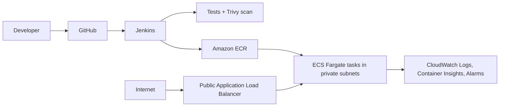

# DevOps Microservice: Jenkins + AWS ECS Fargate

This repository implements the practical challenge from `DevOps Engineer Practical Challenge(1).docx`: a small FastAPI service, Docker image, modular Terraform infrastructure, and a Jenkins CI/CD pipeline for AWS ECS Fargate.

## Architecture



The ALB is the only public application entry point. Tasks run without public IPs in private subnets. This implementation intentionally uses HTTP; HTTPS requires an ACM certificate, an HTTPS listener, and DNS, which are documented future improvements.

## API

- `GET /health` returns a 200 health response.
- `GET /` returns service, version, and environment information.
- `GET /api/v1/message` returns a sample JSON message.

Configuration is supplied with `APP_NAME`, `APP_VERSION`, `ENVIRONMENT`, and `PORT` (default `8000`).

## Repository layout

```text
app/                         FastAPI application
tests/                       pytest tests
Dockerfile                   non-root production image
Jenkinsfile                  CI/CD pipeline
jenkins/docker-compose.yml   local Jenkins controller
terraform/modules/            networking, ECR, ECS, monitoring
terraform/                    dev environment/root composition
scripts/verify.sh             health verification helper
```

## Prerequisites

For local work: Python 3.12+, Docker, curl, Terraform 1.6+, AWS CLI, and Trivy. For AWS: an AWS account and an IAM principal able to create the resources described below. Never put access keys in Git or the image.

## Local validation

```bash
python3 -m venv .venv && . .venv/bin/activate
pip install -r requirements-dev.txt
pytest -q
ruff check app tests

docker compose up --build -d
curl http://localhost:8000/health
docker compose down
```

## Terraform and AWS deployment

The root module creates a VPC, two public and two private subnets, internet gateway, ECR repository with scan-on-push and immutable tags, ECS cluster/service, ALB, CloudWatch log group, IAM roles, and CPU/unhealthy-target alarms. The task role has no extra permissions; the execution role uses the AWS-managed ECS execution policy for image pulls and log delivery.

The private subnets use NAT gateways so Fargate can pull from ECR and publish CloudWatch logs without public task IPs. NAT gateways incur ongoing AWS charges; a cost-optimized production variant can replace them with VPC endpoints for ECR, S3, and CloudWatch Logs.

Terraform state should use an encrypted, versioned S3 bucket with a DynamoDB lock table. Copy `terraform/backend.tf.example` to `terraform/backend.tf`, replace the placeholders, and create the bootstrap bucket/table using your organization's approved process before `terraform init`. `backend.tf` is ignored by Git. A local state file is acceptable only for a disposable learning account.

```bash
cp terraform/terraform.tfvars.example terraform/dev.tfvars
terraform -chdir=terraform init
terraform -chdir=terraform validate
terraform -chdir=terraform plan -var-file=dev.tfvars -var='image_tag=bootstrap'
```

The first real deployment is performed by Jenkins: it creates only ECR during the Push stage, pushes an immutable commit-SHA image, then applies the complete stack with that image. This avoids starting ECS with an image that does not exist. The initial apply creates AWS resources and may incur charges; review the plan and confirm before running it.

## Jenkins setup

```bash
docker compose -f jenkins/docker-compose.yml up -d
docker logs -f jenkins-jenkins-1
```

For a real Jenkins agent, install Docker CLI/daemon access, AWS CLI, Terraform, Python, curl, and Trivy. The Docker socket is powerful; use a dedicated agent and restrict job permissions. Install these plugins: Pipeline, Git, GitHub Integration, Credentials Binding, and AWS Credentials. No paid plugins are required.

Create a Pipeline job connected to this GitHub repository and point it at `Jenkinsfile`. Add a GitHub webhook to `https://JENKINS_HOST/github-webhook/` (or use SCM polling). Configure a Jenkins credential with ID `aws-deploy`, type “AWS Credentials”, scoped to the deployment folder/job. The IAM user or role should be restricted to this repository's ECR actions, ECS service/task-definition actions, ALB/VPC/IAM actions needed by Terraform, CloudWatch log/alarms, and `sts:GetCallerIdentity`; prefer short-lived role credentials in production. Do not echo credentials in shell steps.

The pipeline runs checkout, syntax/Terraform validation, tests, Docker build, Trivy scan, ECR push, Terraform deploy, and an ALB `/health` verification. It uses the Git commit SHA as an immutable image tag, waits for ECS stabilization through Terraform, and skips AWS stages for pull requests (`changeRequest()`). Do not run `terraform destroy` from this pipeline.

## Logs and troubleshooting

```bash
terraform -chdir=terraform output cloudwatch_log_group
aws logs tail /ecs/devops-microservice-dev --follow --region us-east-1
aws ecs describe-services --cluster devops-microservice-dev --services devops-microservice-dev --region us-east-1
```

If tasks stop, inspect ECS stopped-task reasons and CloudWatch logs. Common causes are an image tag that was not pushed, missing execution-role permissions, a security group/health-check mismatch, or no network path from private tasks to ECR/logs. If the ALB is unhealthy, verify `/health` locally, the target port 8000, and the task security group source.

## Cleanup

After confirming the environment is no longer needed, review the plan and run:

```bash
terraform -chdir=terraform destroy -var-file=dev.tfvars
```

This removes the application infrastructure but ECR is configured with `force_delete = false`; delete retained images/repository intentionally if required. Also remove the remote state bucket/table only when no state is using them.

## Assumptions and future improvements

Implemented: non-root image, immutable ECR tags, private ECS tasks, NAT egress, ALB health checks, CloudWatch logs/alarms, resource tags, pull-request deployment guard, and Terraform-managed infrastructure. Not implemented: TLS, VPC endpoints, WAF, secret manager integration, autoscaling, centralized remote-state bootstrap, and a dedicated hardened Jenkins agent. These are appropriate next steps for a larger production service.
